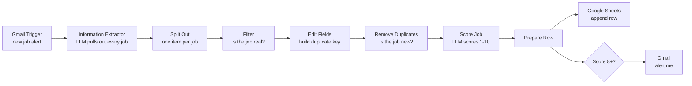
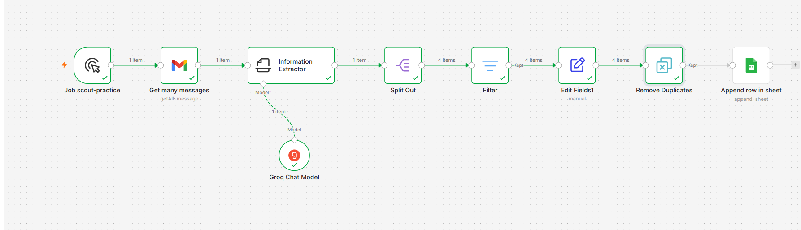
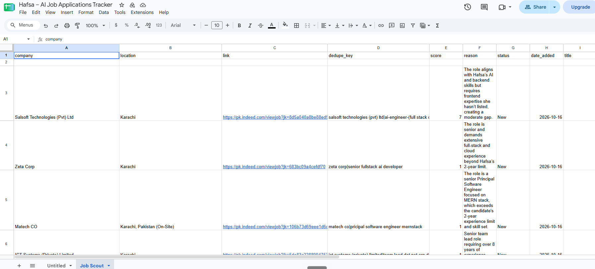

# Job Scout

Two n8n workflows for my job search:

1. **Job Scout** finds and scores jobs from my job alert emails.
2. **Application Package** takes one job description and prepares a tailored resume PDF, a cover letter draft, a LinkedIn message and a recruiter search link, without letting the AI invent experience.

Neither workflow applies for me. They prepare; I check and decide.

📄 **[DEMO_SCRIPT.md](DEMO_SCRIPT.md)**: the 90-second demo, plus the mistakes I made while building this, so you can avoid them.

---

## Workflow 1: Job Scout

An n8n workflow that reads my job alert emails, pulls out every job with an LLM, checks the result against the original email, scores each job against my profile, and adds it to a Google Sheet. If a job scores 8 or higher, I get an email about it.

I built it because I was getting job alerts from Indeed, LinkedIn and Rozee every day and reading them all by hand. Most were senior roles or the wrong stack. Now the workflow reads them, and I only open the jobs worth applying to.

It never applies for me. It only writes new rows. I decide what to do with each job.

### How it works

1. **Gmail Trigger** checks my inbox every 10 minutes for alerts from Indeed, LinkedIn and Rozee.
2. **Clean the email.** Before the LLM sees anything, an expression removes the footer and the long tracking links, and caps the text at 8,000 characters.
3. **Information Extractor** (Groq, `gpt-oss-120b`, temperature 0) turns one email into a list of jobs with fixed fields: title, company, location, link and summary.
4. **Split Out** turns that list into one item per job.
5. **Filter** drops any job whose title does not appear in the original email. This is the check against hallucinated jobs.
6. **Edit Fields** builds a duplicate key: `company|title`, lowercase and trimmed.
7. **Remove Duplicates** blocks any key the workflow has already seen, across all runs.
8. **Score Job** (Groq, `gpt-oss-20b`, temperature 0) scores each new job from 1 to 10 against my profile and gives a one-line reason.
9. **Google Sheets** gets a new row with status `New`. A second branch emails me when the score is 8 or more.
10. The alert email includes a **Prepare application** link. It opens the Application Package form with the job title, company and link already filled in, using URL query parameters.

### Example output

| title | company | score | reason |
|---|---|---|---|
| AI-Engineer (Full Stack Developer) | Salsoft Technologies | 7 | Matches the AI and backend skills, but asks for frontend skills that are not on the profile. |
| Senior Fullstack AI Developer | Zeta Corp | 1 | Senior role that asks for more experience than the 2-year limit. |
| Principal Software Engineer MernStack | Matech CO | 1 | Principal-level MERN role, above the experience limit. |
| Team Lead Dot Net ERP Developer | ICT Systems | 1 | Team lead role that asks for more than 8 years of experience. |

On this real Indeed email, the extractor found all 4 jobs with the correct job links. It even copied a typo in one title ("Pricipal") exactly as written, which is what I want from extraction.

### Design decisions

**LLM instead of regex for extraction.** Each job board formats its emails differently, and the formats change. A regex breaks silently when the layout changes. An LLM reads the email the way a person does. The risk is that it invents jobs, so I validate its output against the source email.

**Duplicate key is company + title, not the link.** The same job has different links on different sites, and tracking links change between emails. Company and title stay the same.

**Two layers of duplicate protection.** The Gmail Trigger only reads emails that arrived after its last check. Remove Duplicates also blocks a job that comes back in a different email.

**Score only new jobs.** The scoring step runs after Remove Duplicates, so LLM tokens go only to jobs I have not seen.

**Model size matches the task.** Extraction from a long email uses the larger model. Scoring one short job uses the smaller one. The two models also have separate rate limits on Groq's free tier.

**My preferences live in one profile.** Target roles, location, experience limit and deal-breakers are in the scoring prompt, with a scoring guide that defines what each score means. To change what counts as a good job, I edit the profile, not the workflow.

**The workflow only appends.** It never edits or deletes a row, and it writes to its own tab in my tracker.

### Problems I hit and how I fixed them

- **The LLM invented jobs.** In one test it returned "Tech Innovators Inc." and "Data Insights LLC", jobs that were not in any email. The node had run without the email text. I fixed the input, told the model to return an empty list when there are no jobs, and added the filter that checks every title against the source email.
- **Rate limits on the free tier.** Groq allows 8,000 tokens per minute. One raw email cost about 5,700 tokens, mostly tracking links. Cleaning the text first cut most of that. I also added batching (one email at a time with a delay) and retries.
- **A second API key would not help.** Groq counts the limit per organization and per model, not per key. Using a different model for scoring was the real fix.
- **The wrong emails.** Some Indeed emails that looked like job alerts were "application submitted" confirmations for jobs I had already applied to. I found this by reading a link parameter (`from=apply-conf`) and switched to the real alert sender.
- **Wrong node order.** I first put the scoring step before Split Out. It received one item that held the whole list, and the API returned "Bad request". Scoring has to happen one job at a time.
- **A memory node used up my test data.** Remove Duplicates blocked all my test jobs because I had tested that node on its own. Its memory is stored per node. Next time I will keep a separate test copy of the workflow.
- **Silent bugs found by reading the export.** Before publishing, I read the exported JSON and found that the title field was filled with the location, and that the alert filter used "equals 8" instead of "8 or more", so the best jobs never sent an alert. Neither bug showed an error.
- **Data types.** Two filters failed because they compared a number or a true/false value with a text operator.
- **Timezone.** Dates came out a day behind until I set the workflow timezone to Asia/Karachi.

### Evaluation

Planned: I will score 20 real jobs by hand and compare my scores with the LLM's scores. The result will go here.

---

## Workflow 2: Application Package

When I find a job worth applying to, I open a form (or click the link in a Job Scout alert), paste the full job description and submit. A minute later, my browser opens a Google Doc with everything I need to apply.

```mermaid
flowchart LR
    A[Form<br/>job + description] --> B[My Resume<br/>source of truth]
    B --> C[Tailor Bullets<br/>LLM rewords 13 bullets]
    C --> D[Guardrail<br/>check + auto-repair]
    D --> E[Write Letter & DM<br/>LLM draft]
    E --> F[Letter Check]
    F --> G[Search Link<br/>recruiter search]
    G --> H[Copy Template<br/>Drive]
    H --> I[Fill Resume<br/>Docs]
    I --> J[Export + Save PDF]
    J --> K[Package Doc]
    K --> L[Log to tracker<br/>status Ready]
    L --> M[Redirect to<br/>Package Doc]
```

1. **Form Trigger** takes the job title, company, link and full job description.
2. **My Resume** holds my real resume as text. Every check compares against it.
3. **Tailor Bullets** (Groq, `gpt-oss-120b`, temperature 0) rewrites all 13 resume bullets for the job. It may change verbs and word order. It may not add tools, numbers, claims or phrases.
4. **Guardrail** (JavaScript) checks the output against my real resume:
   - normalizes Unicode dashes and spaces first, so look-alike characters can't hide words;
   - flags any tool name or number that isn't in my resume;
   - checks that there are exactly 13 bullets;
   - **novelty check with auto-repair:** if a bullet adds more than 3 words that appear nowhere in my resume, it is replaced with my original bullet and flagged.
5. **Write Letter & DM** (`gpt-oss-20b`) drafts a short cover letter and a LinkedIn message, using only the checked bullets. **Letter Check** flags skills from the job description and clichés.
6. **Search Link** builds a Google search for the company's recruiters on LinkedIn. No scraping: I pick the person.
7. **Copy Template → Fill Resume → Export PDF → Save PDF** copy my resume template (a Google Doc with `{{B1}}`–`{{B13}}` placeholders), fill in the checked bullets, and save a PDF. My name, dates and education never pass through the LLM.
8. **Package Doc** collects the PDF link, check results, letter draft, DM, recruiter search and a "before you apply" checklist.
9. **Google Sheets** logs the application with status `Ready`. I change it to `Applied` myself after sending.

### Design decisions

**The LLM never writes the whole resume.** It only rewords bullets. The layout, dates, education and contact details come from a fixed template, so they can't be changed.

**Fail safe, not just warn.** A warning is easy to ignore when you're tired. When a bullet stretches the truth, the guardrail puts my original bullet back. Unchanged is better than stretched.

**Check every LLM output separately.** The resume bullets and the cover letter each have their own check. A check on the first output doesn't protect the second.

**Human in the loop.** The workflow prepares; I review, edit the letter and apply. The cover letter is a draft, and I write the final version myself.

**Connected to Job Scout by a link, not full automation.** Alert emails only contain a short summary, and tailoring from a summary gives weak results. A pre-filled form link lets me add the full job description and decide which jobs deserve a package before any LLM tokens are spent.

---

## Limitations

- It runs on my laptop with self-hosted n8n, so it only works while the laptop and n8n are on.
- The Google OAuth app is in testing mode, so the Google connection must be renewed every 7 days.
- It only sees jobs that arrive as email alerts.
- The LLM can still make mistakes. The filter catches invented jobs, but not every wrong score.
- The resume guardrail catches added words, not every subtle change of meaning. I still read every bullet before sending.
- The Prepare application link uses `localhost`, so it only opens on the laptop running n8n.

## Roadmap (version 2)

- Pull jobs from job APIs (for example JSearch or Remotive) in addition to email.
- Host it so it runs 24/7.
- Let other people upload a resume and get their own profile.
- Expose Job Scout as an MCP tool, so an AI assistant can ask "what are my best jobs this week?"

## Tech stack

n8n (self-hosted) · Groq (`openai/gpt-oss-120b`, `openai/gpt-oss-20b`) · Gmail API · Google Sheets, Docs and Drive APIs · OAuth 2.0

## Run it yourself

1. Install n8n: `npm install -g n8n`, then run `n8n` and open `http://localhost:5678`.
2. Import `job-scout-workflow.json` (menu → Import from File).
3. Create credentials for Gmail, Google Sheets and Groq. API keys stay in n8n and are not in this file.
4. In the Google Sheets node, replace `YOUR_SHEET_ID` with your sheet. Add these headers to row 1:
   `title | company | location | link | dedupe_key | score | reason | status | date_added`
5. Edit the profile in the **Score Job** node so it describes you.
6. Set the alert email address in the **Send a message** node.
7. Set the workflow timezone, save, and activate it.

**Application Package:**

1. Import `application-package-workflow.json`.
2. Create credentials for Groq, Google Drive, Google Docs and Google Sheets.
3. Make a resume template as a **Google Doc** (not a .docx), with `{{B1}}` to `{{B13}}` where your bullets go. Put its ID in **Copy Template**.
4. Paste your resume text into **My Resume**, and update the bullet count and order in the **Tailor Bullets** prompt and the **Guardrail**.
5. Set your folder ID in **Create Package** and your sheet ID in **Log Application**. Add an `Applications` tab with these headers in row 1:
   `date | job_title | company | job_link | resume_pdf | package_doc | checks | status`
6. Publish the workflow and open the form's **Production URL**. After any change: save, then publish again.

---

Built by Hafsa Noor · [LinkedIn](https://www.linkedin.com/in/hafsanoorr)
